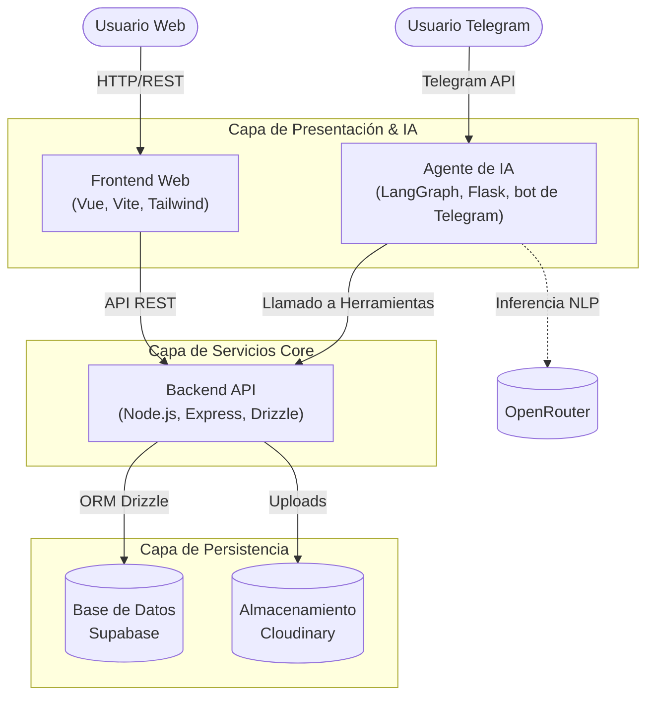

# 🐻 Guardacosas: el inventario de tu hogar 🏠🍓

> 🍎 ¿Dónde quedó el taladro? 🍊 ¿Cuántas pilas nos quedan? 🍋 ¿Quién se llevó el rallador? 🍇
> Aquí cada cosa tiene su cuarto, su lugar y un osito que la cuida.

Guardacosas es un sistema para llevar el inventario de la casa sin que se sienta como una hoja de cálculo. Lo puedes manejar desde una web que parece un juguete, o simplemente platicarle al **agente de IA**, que contesta por la terminal, por una API o por **Telegram** 🍌.

## 🧸 Conoce a los guardianes

| Osito | Cuida | Lo suyo |
|---|---|---|
| 🍳 **Pimienta** | la cocina | Sabe dónde está la olla de presión y quién se llevó el rallador. |
| 🔧 **Tuerca** | el taller | Lleva la cuenta de lo que prestaste y de lo que sigue sin arreglar. |
| 📚 **Página** | el estudio | Ordena la biblioteca por tema y apunta una nota en cada ejemplar. |
| 📦 **Caja** | la bodega | Cuida lo que no usas todos los días, con una foto de cada caja. |

## 🌟 Características Principales
- 🎠 **Una web que es un juguete**: todo se ve como un mundo de plastilina con osos «guardianes». La página de inicio es un parque con rueda de la fortuna, carrusel y trencito, y un osito que baja una escalera mientras haces scroll. Al iniciar sesión llegas a la entrada de una casita, y cada pantalla (buscar, habitantes, vincular el bot, guardar algo) es un menú de juego con su propio escenario de fondo.
- 🏘️ **Tu casa como un barrio**: cada categoría es un cuarto y se ve como una casita de su propio color en una isla. Puedes girar la isla, elegir una casa y entrar a su cuarto, o caminar en primera persona, abrir puertas, manejar los carros 🚗 y cruzar puentes a otras islitas.
- 🍓 **Cada cosa con su lugar**: los artículos se guardan con foto, cantidad, notas y una ubicación (por ejemplo, «estante de arriba»), y se ven como las casillas de un inventario de juego.
- 🤖 **Asistente de IA (Agente)**: un agente inteligente (Python) al que le hablas normal: «se me acabaron las pilas», «le presté el taladro a mi cuñado». Busca por coincidencia aproximada, aunque escribas mal, y funciona desde la terminal, una API HTTP o un bot de Telegram, desde cualquier lugar.
- ☁️ **Persistencia**: base de datos en Supabase (PostgreSQL) e imágenes en Cloudinary.
- 📊 **Reportes**: descarga y exportación del inventario a Excel.

## 🏗 Arquitectura del Sistema

El sistema sigue una arquitectura distribuida basada en contenedores, separando claramente las responsabilidades (Frontend, Backend y Agente IA con su bot de Telegram):



## 🛠 Stack Tecnológico

*   **Frontend**: Vue 3, Vite, Tailwind CSS, TypeScript, three.js para las escenas 3D (con física de Rapier) y Pinia para el estado del paseo.
*   **Backend**: Node.js, Express, Drizzle ORM, TypeScript.
*   **Inteligencia Artificial**: Python, LangChain/LangGraph, OpenRouter.
*   **Infraestructura**: Docker, Docker Compose, Nginx.

## 🚀 Despliegue Local

El proyecto incluye un `docker-compose.yaml` orquestado para levantar todo el stack con facilidad.

1. Configura las variables copiando los `.env.example` a `.env` en los distintos directorios (Ver la [Documentación de Variables de Entorno](./docs/variables-entorno.md)).
2. Levanta los servicios con Docker:
   ```bash
   docker compose up -d --build
   ```

## 🧰 Desarrollo con Turborepo

El monorepo usa npm workspaces (`frontend`, `backend`, `agente`) orquestados con Turborepo. Desde la raíz:

```bash
npm install            # instala todos los workspaces
npm run dev            # levanta frontend, backend y agente en paralelo
npm run build          # compila frontend y backend (con caché)
npm run typecheck      # revisa tipos de frontend y backend y sintaxis del agente
npm run db:push        # crea o actualiza las tablas en la base de datos (DATABASE_URL de backend/.env)
npm run db:generate    # genera migraciones SQL desde el esquema (backend/drizzle)
npm run db:migrate     # aplica las migraciones generadas
npm run user:create -- <usuario> <contraseña>   # crea un usuario para iniciar sesión
```

### Docker desde la raíz

```bash
npm run docker:up        # construye y levanta todo el stack (docker compose up -d --build)
npm run docker:down      # detiene y elimina los contenedores del compose
npm run docker:clean     # elimina contenedores e imágenes del sistema (conserva los volúmenes)
npm run docker:rebuild   # docker:clean y luego docker:up
```

`docker:clean` y `docker:rebuild` también eliminan los contenedores `inventario-*` y las imágenes `inventarioarticuloscasa-*` y `*/inventario-*` que ya no pertenecen al compose (por ejemplo `inventario-bot` o `inventario-ftp`). Los volúmenes, incluida la base de datos local, se conservan salvo que añadas `-- --volumes`. Con `-- --dry-run` solo muestra lo que borraría.

Las imágenes de `backend` y `frontend` se construyen desde la raíz del repositorio: cada `Dockerfile` usa `turbo prune <paquete> --docker` para copiar solo los paquetes que necesita y reutilizar la caché de dependencias.

## ☁️ Publicarlo en internet (Vercel)

Cada parte vive en su propio proyecto de Vercel:

- `guardacosas`: la página web.
- `guardacosas-backend`: el servidor que guarda los datos.
- `guardacosas-agente`: el asistente que contesta en Telegram.

Cada vez que se sube un cambio a la rama principal, la web y el servidor se actualizan solos. El asistente se
publica a mano desde su carpeta (ver `agente/README.md`). Las claves y contraseñas se configuran en cada proyecto de
Vercel, nunca en el código.

## 📦 Estructura del Repositorio

*   `/backend`: API RESTful que administra la lógica de negocio y persistencia.
*   `/frontend`: Cliente web (SPA) para la gestión visual.
*   `/agente`: Servicio de inteligencia artificial que procesa intenciones y coordina respuestas; incluye el bot de Telegram.
*   `/docs`: Guías y documentación técnica del proyecto.
*   `/supabase`: Scripts SQL de inicialización para el entorno de base de datos local.
