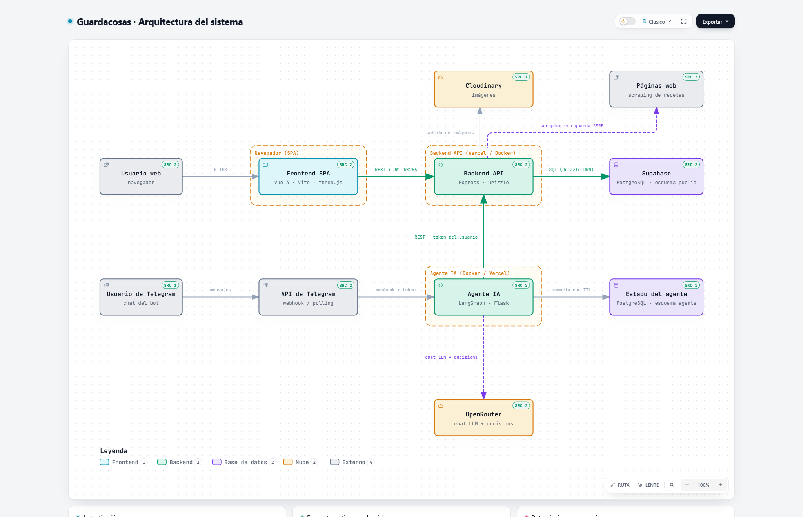
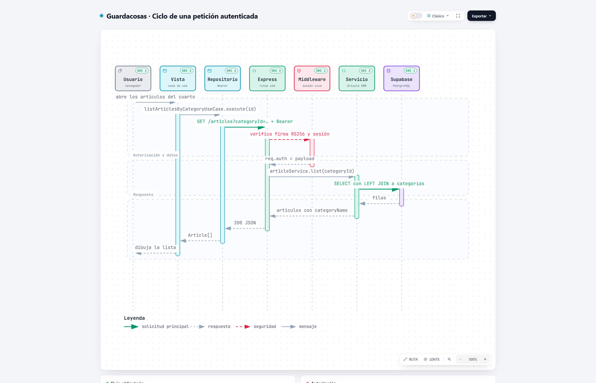
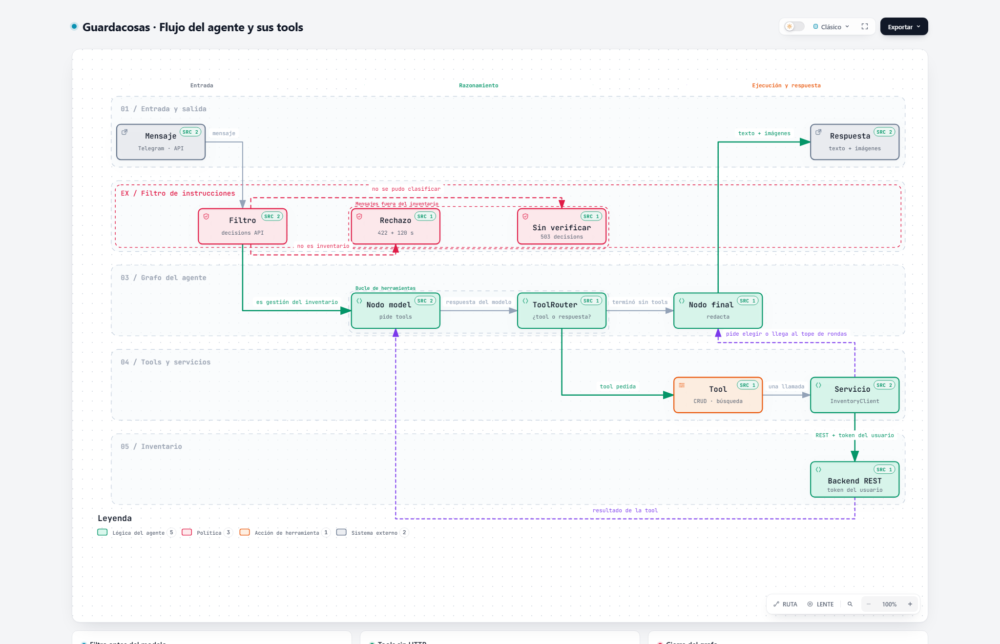

# 🏗 Arquitectura de Guardacosas

Tres mapas del sistema para entender de un vistazo cómo encaja todo. Cada diagrama tiene además
una versión interactiva en HTML: se abre con doble clic y puedes buscar nodos, recorrer las rutas
una por una, cambiar a modo oscuro y exportar la imagen.

| Mapa | Versión interactiva |
|---|---|
| El sistema completo | [`arquitectura-sistema.html`](arquitectura-sistema.html) |
| El viaje de una petición | [`ciclo-peticion.html`](ciclo-peticion.html) |
| Cómo conversa el agente | [`flujo-agente.html`](flujo-agente.html) |

---

## 1. El sistema completo



Hay dos caminos para entrar a Guardacosas y uno solo para guardar las cosas:

- **Desde la web**: la persona entra al SPA (Vue + three.js) y este le habla con el backend por REST.
- **Desde Telegram**: la persona escribe al bot; el bot (el agente) le habla al mismo backend.
- **El backend** es el único que toca los datos: guarda el inventario en Supabase (PostgreSQL) y las
  fotos en Cloudinary.
- **El agente** no guarda credenciales propias: usa el token de la persona, guarda su memoria con
  caducidad en su propia tabla y le pregunta a OpenRouter (modelo de lenguaje y filtro de mensajes).
- **El scraping** de recetas es opcional: el backend abre la página con Chromium y solo deja pasar
  direcciones públicas.

---

## 2. El viaje de una petición



Qué pasa cuando abres un cuarto y se listan sus artículos:

1. La **vista** llama a un **caso de uso** (nunca hace peticiones por su cuenta).
2. El **repositorio** arma la llamada y el **cliente HTTP** le pone el token de la persona.
3. En el backend, la **ruta de Express** valida los datos y pide permiso al **middleware de
   autenticación**, que revisa la firma del token y que la sesión siga viva.
4. El **servicio** pregunta a **Supabase** con Drizzle y devuelve los artículos.
5. Todo el camino de vuelta: filas → artículos → JSON → lista dibujada.

Si el token no vale o la sesión se cerró, la respuesta es un `401` y la web olvida el token.

---

## 3. Cómo conversa el agente



El agente es un diagrama con tres estados (piensa, usa herramientas, responde) y dos filtros por
delante:

- **Primero se filtra el mensaje.** Se pregunta a OpenRouter si es una gestión del inventario. Si no
  lo es, se responde `422` y la persona espera dos minutos. Si ni se puede clasificar, `503`.
- **Después razona y usa herramientas.** Cada herramienta (listar, buscar, subir una imagen, revisar
  una lista) es una llamada corta a un servicio; los servicios son los únicos que hablan con el
  backend.
- **Y vuelve a empezar** con el resultado de la herramienta, hasta que la respuesta esté lista o
  haya que pedirle a la persona que elija entre dos coincidencias.

---

## Cómo se mantienen estos mapas

Los tres diagramas se sacan del código, no de memoria: cada caja apunta a los archivos reales del
repositorio. Si cambia el sistema, se edita el diagrama en [`candidatos/`](candidatos/) y se vuelve a
generar:

```bash
node scripts/archify/run-archify.mjs finalize architecture \
  docs/arquitectura/candidatos/arquitectura-sistema.json \
  docs/arquitectura/arquitectura-sistema.html \
  --quality showcase --repo-root . --json
```

Después se copia la captura nueva a `imagenes/`. El comando usa el Chrome que encuentre en el
equipo (o el de pruebas que trae la skill) para comprobar el resultado en un navegador de verdad.
